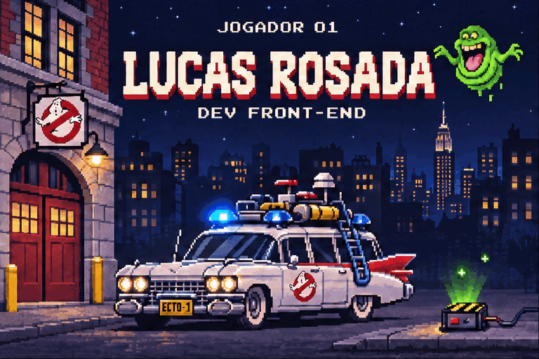

<!-- Banner hospedado no Postimg; clique na imagem para abrir a página original. -->

  

**Desenvolvimento front-end · JavaScript · UI/UX**

Construindo interfaces e caçando os bugs que assombram o console.

### 👾 Jogador 01 · Lucas Rosada

Trabalho com **desenvolvimento front-end**, estou aprendendo **frameworks modernos de JavaScript** e busco trocar experiências sobre **boas práticas de UI/UX**.

### ⚡ Selecione seu equipamento

**Interfaces**

**Back-end e dados**

**Linguagens**

**Ferramentas**

### 📟 Radar de atividade

 

**Próxima missão: transformar ideias em interfaces.**

Inspirado em Ghostbusters (1984). Não cruze os feixes.

Créditos e referências visuais

Arte personalizada gerada para este perfil, inspirada no Ecto-1, no Slimer e nos equipamentos do filme clássico.

- [Ghostbusters (1984) — Sony Pictures](https://www.sonypictures.com/movies/ghostbusters)
- [Acervo visual Sony/Ghost Corps — Spook Central](https://www.spook-central.com/2017/02/20/official-ghostbusters-creative-assets)

