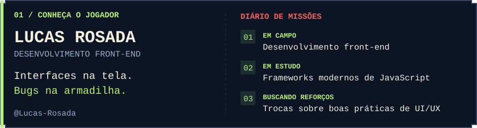
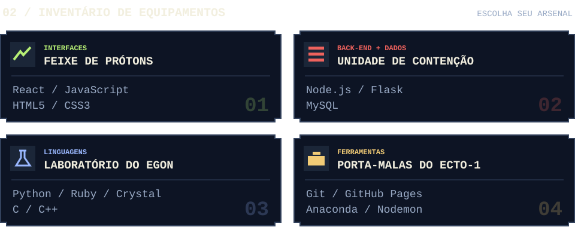

<!-- Publicação: envie o README e a pasta github-profile-assets juntos. -->

**Tem alguma coisa estranha no seu console?**
 
Desenvolvimento front-end, uma missão de cada vez.

  

  

  

  

🚫 👻 &nbsp; NÃO CRUZE OS FEIXES. &nbsp; · &nbsp; SALVE SEU PROGRESSO.

📋 Abrir diário de bordo

Sou **Lucas Rosada** e trabalho com **desenvolvimento front-end**. Atualmente, estou aprendendo **frameworks modernos de JavaScript** e busco trocar experiências sobre **boas práticas de UI/UX**.

| Equipamento | Tecnologias |
| :--- | :--- |
| Interfaces | React, JavaScript, HTML5 e CSS3 |
| Back-end e dados | Node.js, Flask e MySQL |
| Linguagens | Python, Ruby, Crystal, C e C++ |
| Ferramentas | Git, GitHub Pages, Anaconda e Nodemon |

🎬 Créditos da missão

Identidade de fã inspirada em **Ghostbusters (1984)**. Arte em pixel art gerada para este perfil; painéis em SVG personalizados. Os painéis apresentam informações do perfil, sem pontuações ou métricas fictícias.

- [Ghostbusters (1984) — Sony Pictures](https://www.sonypictures.com/movies/ghostbusters)
- [Acervo visual Sony/Ghost Corps — Spook Central](https://www.spook-central.com/2017/02/20/official-ghostbusters-creative-assets)

